  <h1>G · Deluxeg4</h1>
  
   
  
  
  

---

## 👋 About Me

Hi, I’m **G** — a computer science student interested in Minecraft server software and practical tools for multiplayer communities. 🎮

## 🧰 Tech Stack

  <picture>
    <source media="(prefers-color-scheme: dark)" srcset="https://skillicons.dev/icons?i=c%2Ccpp%2Ccs%2Cjava%2Cgradle%2Cgit%2Cgithub&theme=dark" />
    <source media="(prefers-color-scheme: light)" srcset="https://skillicons.dev/icons?i=c%2Ccpp%2Ccs%2Cjava%2Cgradle%2Cgit%2Cgithub&theme=light" />
    
  </picture>

## 🚀 Featured Projects

| Project | Description |
| --- | --- |
| **[UtilityPlus](https://github.com/Deluxeg4/UtilityPlus)** | Paper and Folia plugin with homes, teleport requests, teams, and server tools. |
| **[VelocityQueue](https://github.com/Deluxeg4/VelocityQueue)** | Velocity proxy plugin that queues players until the main server has room. |
| **[PremiumSyncUUID](https://github.com/Deluxeg4/PremiumSyncUUID)** | Syncs player data when a player switches from offline UUID to online UUID. |
| **[GpsSpeedometer10Hz](https://github.com/Deluxeg4/GpsSpeedometer10Hz)** | GPS speedometer project featured among my pinned repositories. |

## 📊 GitHub Stats

  <picture>
    <source media="(prefers-color-scheme: dark)" srcset="./profile/stats-tokyonight.svg" />
    <source media="(prefers-color-scheme: light)" srcset="./profile/stats-default.svg" />
    
  </picture>
  <picture>
    <source media="(prefers-color-scheme: dark)" srcset="./profile/top-langs-tokyonight.svg" />
    <source media="(prefers-color-scheme: light)" srcset="./profile/top-langs-default.svg" />
    
  </picture>

  <picture>
    <source media="(prefers-color-scheme: dark)" srcset="./profile/streak-tokyonight.svg" />
    <source media="(prefers-color-scheme: light)" srcset="./profile/streak-default.svg" />
    
  </picture>

  Building useful things for better multiplayer worlds. ✨

